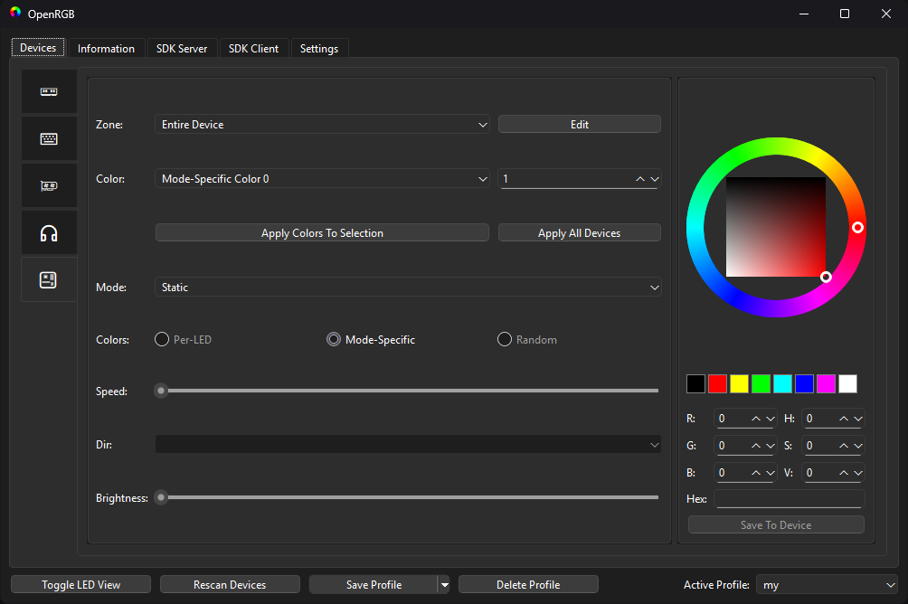
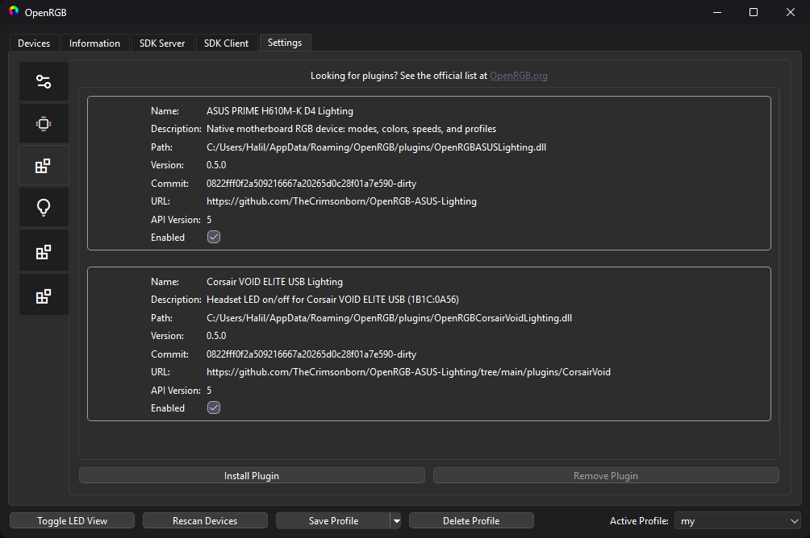

> **Disclaimer:** This project was created entirely using **Codex 6.1 Sol**. The motherboard functionality has only been tested on the **ASUS PRIME H610M-K D4 motherboard**. Headset functionality targets only the **Corsair VOID ELITE USB (VID 1B1C, PID 0A56)**. Other devices and configurations have not been tested or verified.

# OpenRGB ASUS and Corsair VOID Lighting 0.5.0

Two independently installable Windows x64 plugins for **OpenRGB 1.1 / Plugin API 5**, built with **MSVC 2022 and Qt 6.8.3**. They register real OpenRGB controller entries, so both devices appear in **Devices** and **Information** with the application's standard motherboard/headset icons.

| Plugin DLL | Device | Controls |
| --- | --- | --- |
| `OpenRGBASUSLighting.dll` | ASUS PRIME H610M-K D4 | Static, Blinking, Fading, Strobing, Off; 1-8 color stages and mode-specific speeds |
| `OpenRGBCorsairVoidLighting.dll` | Corsair VOID ELITE USB | LED On / Off |

Install either plugin or both. No ASUS, Corsair, Qt, or driver binaries are bundled. Extra diagnostic pages are under Settings; there are no extra top-level plugin tabs.

## Screenshots

Native motherboard controls and standard device icons:



Separate plugins with automatically generated source commit and URL metadata:



The screenshots show a development build. Published DLLs are built from the release commit without the development `-dirty` suffix.

## Install

Download the standalone DLL(s) or separate Windows x64 ZIPs from [Releases](https://github.com/TheCrimsonborn/OpenRGB-ASUS-Lighting/releases). Matching source and SHA-256 checksums are included in the release assets.

1. Close OpenRGB and copy the selected plugin DLL(s) into `%APPDATA%\OpenRGB\plugins`.
2. Keep OpenRGB's original `PawnIOLib.dll`, `LpcIO.bin`, and `hidapi-hotplug.dll` beside `OpenRGB.exe`.
3. Start OpenRGB as administrator and select the motherboard or headset under **Devices**. Their identities and connection details are under **Information**.
4. Choose a mode with OpenRGB's normal controls. Close AI Suite/iCUE or other tools that could compete for the same device.

The sidebar follows OpenRGB's compact device view, using native icons. Use OpenRGB's normal profile save/load for these devices. Save a new profile containing the new devices if an older profile predates their installation.

## ASUS controls

Static, Blinking, Fading, Strobing, and Off are native device modes. Non-Off modes support 1-8 mode-specific color stages. Select a stage, edit its color, and apply it using OpenRGB. The sequence repeats over the hardware's eight packed entries. RGB channels have 4-bit precision. Blinking and Strobing expose a speed range of 0-2 (slow/middle/fast); the other modes use vendor timing defaults.

This controls the motherboard RGB header; RAM, keyboard, and GPU remain separate devices. Other motherboard models are rejected by an exact SMBIOS product check.

## VOID headset controls

Select **Off** or **On** in the headset's Mode control. On re-enables the headset's existing effect. The plugin does not change headset colors, audio, microphone, or firmware.

Only USB VID 1B1C / PID 0A56, interface 3, usage FFC5:0001 is targeted. Enumeration must yield exactly one matching interface. Each requested mode change opens the current device path, writes one LED payload, and closes it. Windows may pad the three-byte payload to the report size. The physical LED state is not queried. LED Off was physically confirmed by the user; On uses the matching protocol command and still needs physical confirmation.

See [the headset implementation notes](plugins/CorsairVoid/README.md).

## Startup, profiles, and diagnostics

The host owns device state and profiles. OpenRGB may apply a default mode or a configured profile during device registration/startup. The initial displayed mode is not a physical state query. To restore a chosen lighting state, save and configure an OpenRGB profile containing these devices.

Version 0.5.0 uses native OpenRGB profiles instead of the ASUS plugin's former standalone JSON profile UI. Older native profiles without these devices should be saved again after choosing their settings. Diagnostic pages and last-command errors are available under Settings. Register/HID write success alone does not prove physical LED behavior. No reboot is required by the plugins.

## Build and checks

Requirements: CMake 3.21+, Visual Studio 2022 C++ x64 build tools and Windows SDK, Qt **6.8.3 MSVC 2022 64-bit**, and a complete OpenRGB 1.1 source tree. The compiler and Qt runtime must match the host application.

```powershell
git clone --filter=blob:none https://gitlab.com/CalcProgrammer1/OpenRGB.git external/OpenRGB
git -C external/OpenRGB checkout 8e16de27858cf2be6af54a33ce003df74cb9fd3e
```

Open **x64 Native Tools Command Prompt for VS 2022**, start PowerShell there, and run from the repository root (adjust the Qt path):

```powershell
.\scripts\Build.ps1 -QtRoot "C:\Qt\6.8.3\msvc2022_64" -OpenRGBSource ".\external\OpenRGB" -RunChecks
```

The script builds both DLLs serially with NMake and places them plus checksums in `dist/`. Generated outputs and dependencies are excluded from Git. Commit and URL metadata are generated at configure time from Git; uncommitted tracked changes append `-dirty`. A source archive without Git metadata shows `unknown` unless a commit value is supplied when configuring.

Checks cover mode/speed constants, RGB packing, input validation, native motherboard/headset device definitions, target filtering, LED packets, metadata consistency, and plugin construction/unload. They do not send hardware commands. The user confirmed the ASUS controls and headset LED Off on the supported hardware.

## Hardware mapping evidence

The ASUS mapping was derived by static inspection of Light Control 1.00.28 SIORGB.dll: map initialization 0x418467/data 0x506D90, timing defaults 0x420F54, palette packing 0x421134, write transaction 0x421244, speed mapping 0x4218D0 (image base 0x400000).

LDN12 ED is updated with `ED | 0xE0`. LDN13 FF mode is `((FF | 1) & 0xF9) | (mode << 1)`. Off is mode 1 and skips palette/timing writes. FC selects single/multiple color, not power. F0-F3 hold red pairs, F4-F7 green pairs, and F8-FB blue pairs; each byte packs two four-bit values. Timing registers are in LDN15. Access uses the shared ISA mutex and restores the previous logical device and configuration-mode exit.

References: [PawnIO LPC module](https://github.com/namazso/PawnIO.Modules/blob/main/LpcIO.p), [HeadsetControl VOID LED command](https://github.com/Sapd/HeadsetControl/blob/master/lib/devices/corsair_void_rich.hpp).

## License

GPL-2.0-or-later; see [LICENSE](LICENSE), [THIRD_PARTY_NOTICES.md](THIRD_PARTY_NOTICES.md), [CHANGELOG.md](CHANGELOG.md), and [CONTRIBUTING.md](CONTRIBUTING.md). This is an independent project, not an official ASUS, Corsair, or OpenRGB plugin.
