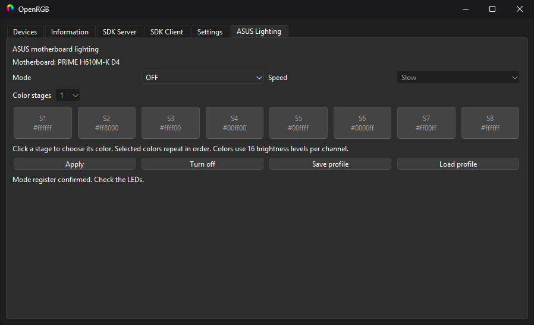
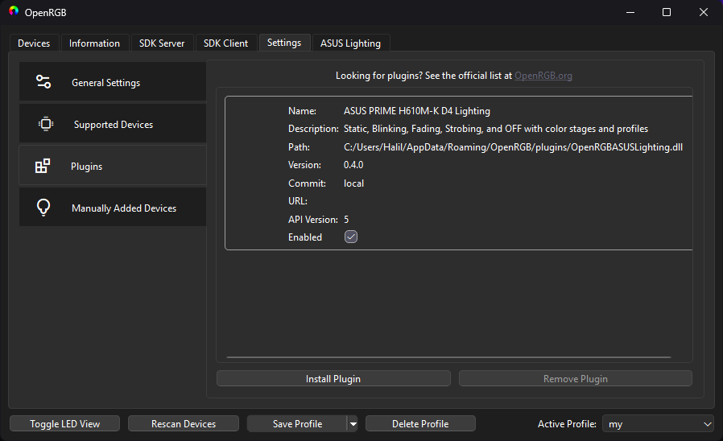

> **Disclaimer:** This project was created entirely using **Codex 6.1 Sol**. It has only been tested on the **ASUS PRIME H610M-K D4 motherboard**. Compatibility with any other motherboard or hardware configuration has not been tested or verified.

# OpenRGB ASUS Lighting 0.4.0

Windows x64 plugin for ASUS PRIME H610M-K D4 and OpenRGB 1.1 / Plugin API 5. Built with MSVC 2022 and Qt 6.8.3. Uses the existing OpenRGB PawnIOLib.dll and signed LpcIO.bin. Exact motherboard model is checked before commands are enabled.

## Screenshots

The ASUS Lighting tab provides mode selection, color stages, speed controls, and profile management.



The plugin appears in OpenRGB's plugin settings as version 0.4.0 with Plugin API 5 support.



## Install

Download the standalone DLL or Windows x64 ZIP from the [v0.4.0 release](https://github.com/TheCrimsonborn/OpenRGB-ASUS-Lighting/releases/tag/v0.4.0). Matching source code and SHA-256 checksums are included in the release assets.

Close OpenRGB and copy `OpenRGBASUSLighting.dll` into `%APPDATA%\OpenRGB\plugins`. Start OpenRGB as administrator and open the **ASUS Lighting** tab. Keep the original `PawnIOLib.dll` and `LpcIO.bin` beside `OpenRGB.exe`.

This controls the motherboard RGB output. RAM, keyboard, and GPU lighting remain separate devices. Other boards are blocked; other OpenRGB/toolchain combinations have not been validated. No ASUS binaries are loaded or distributed by this plugin.

## Controls

Select Static, Blinking, Fading, Strobing, or OFF. Choose 1, 2, 4, or 8 color stages, and click each stage to choose its color. The selected sequence repeats across the eight hardware entries. Colors have 4-bit precision per channel. Blinking and Strobing expose Slow, Middle, and Fast; the other modes use the vendor timing defaults. Apply sends the selected settings; Turn off sends OFF immediately. Merely selecting settings or opening the plugin sends no lighting commands.

Save profile and Load profile use JSON files. OpenRGB profile save/load also stores/restores the controls. Loading a profile only fills the controls; click Apply to send it. Invalid profiles leave the current settings intact.

Close AI Suite and other motherboard control applications before applying settings, to avoid simultaneous access. No reboot is required by the plugin.

## Hardware mapping evidence

Static analysis of installed Light Control SIORGB.dll 1.00.28:

- 0x418467 onward / data 0x506D90 onward: UI modes 0,1,2,3,4 map to vendor modes 0,1,2,3,0x11.
- 0x420F54: Static defaults 6/5/6/5; Fading 3/3/6/5; Strobing vendor mode 0x11 becomes hardware mode 3 with timing 2/15/255/255.
- 0x4218D0: Blinking speeds 0x10/8/1; Strobing speeds 0x10/0x0A/7.
- 0x421134: two color values pack into high/low nibbles. F0-F3 hold red pairs, F4-F7 green pairs, F8-FB blue pairs.
- 0x421244: LDN12 ED |= E0 then LDN13 FF mode field; OFF is mode 1 and skips palette/timing writes. FC selects single/multiple color, not power.

All access uses the shared ISA mutex, bounded waits, checked PawnIO results, restored logical-device selection, and configuration-mode exit. Mode bits are read back after a command. Register read-back does not prove the physical LED behavior.

The user confirmed that version 0.4.0 works on the target board. That report does not constitute exhaustive testing of every speed, palette, or system configuration.

## Build and checks

Requirements: CMake 3.21+, Visual Studio 2022 C++ x64 build tools, Windows SDK, and the Qt 6.8.3 MSVC 2022 64-bit kit. The Qt/compiler combination must match the host OpenRGB build.

Fetch the reference OpenRGB source from the repository root:

```powershell
git clone --filter=blob:none https://gitlab.com/CalcProgrammer1/OpenRGB.git external/OpenRGB
git -C external/OpenRGB checkout 8e16de27858cf2be6af54a33ce003df74cb9fd3e
```

Open **x64 Native Tools Command Prompt for VS 2022**, start PowerShell there, then run from this repository root, adjusting the Qt path:

```powershell
.\scripts\Build.ps1 -QtRoot "C:\Qt\6.8.3\msvc2022_64" -OpenRGBSource ".\external\OpenRGB" -RunChecks
```

The script builds Release with NMake and writes the DLL plus SHA-256 checksum to `dist/`. It does not install the plugin or send hardware commands. Generated `build/`, `dist/`, and downloaded `external/` dependencies are excluded from Git. Use a clean build directory if changing generators or compilers.

For manual CMake configuration, set `OPENRGB_SOURCE_DIR` to a complete OpenRGB 1.1 source tree and `CMAKE_PREFIX_PATH` to the matching Qt kit.

Enable ASUS_LIGHTING_BUILD_CHECKS to build ASUSLightingChecks. Run it with the full plugin DLL path and the matching Qt bin directory on PATH. Checks cover vendor mode/speed constants, nibble packing, range rejection, mode/speed/stage UI behavior, OpenRGB profile round-trip, and invalid-profile preservation. They do not invoke hardware commands.

Checks passed with the Qt 6.8.3 MSVC build. The build script compiles serially to limit memory use.

Reference: [PawnIO LPC module](https://github.com/namazso/PawnIO.Modules/blob/main/LpcIO.p).

## License

GPL-2.0-or-later; see [LICENSE](LICENSE) and [THIRD_PARTY_NOTICES.md](THIRD_PARTY_NOTICES.md). This is an independent project, not an official ASUS or OpenRGB plugin. See [CHANGELOG.md](CHANGELOG.md) for version history and [CONTRIBUTING.md](CONTRIBUTING.md) for contribution guidance.
